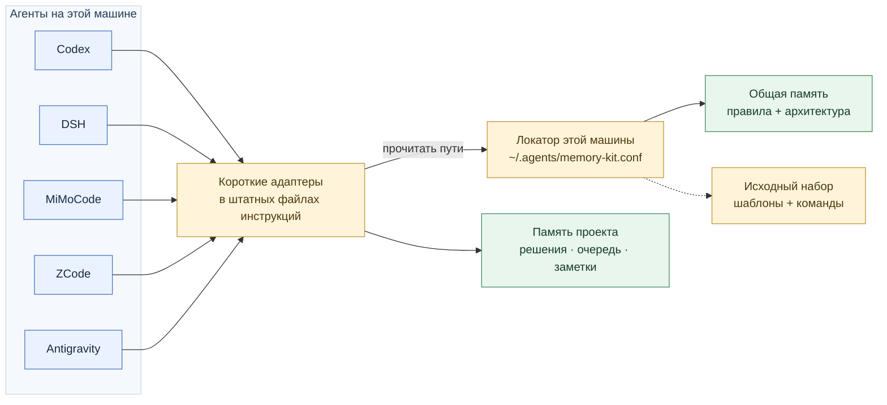

# Codex Memory Kit

**Одна файловая память для нескольких ИИ-агентов и проектов.** Набор сохраняет ваши правила работы, решения и очередь задач в обычных Markdown-файлах. Короткие адаптеры подключают к ним Codex, DSH, MiMoCode, ZCode и Antigravity.

Имя репозитория историческое: общая память и проектные файлы не привязаны к Codex. Для работы не нужны сервер памяти, база данных или GitHub-коннектор.

[Быстрый старт](#быстрый-старт) · [Выбор агента](#выбор-агента) · [Устройство памяти](#как-устроена-память) · [Перенос](#экспорт-и-импорт) · [Совместимость и источники](docs/harness-compatibility.md)

## Как устроена память



Общие правила хранятся в одном выбранном каталоге, по умолчанию `~/.agents/memories`. Проект хранит собственные решения рядом с кодом. Служебные пути конкретной машины вынесены в локатор: при переносе текста памяти их не нужно переписывать.

Стрелки показывают связи между слоями. Markdown-ссылка сама не импортирует файл: адаптер явно поручает агенту прочитать общие правила и проектный стартовый слой. Наличие файлов ещё не подтверждает загрузку конкретной сессией.

## Быстрый старт

Клонируйте набор в удобный каталог либо используйте уже имеющийся checkout:

```bash
git clone https://github.com/phoenix0597/codex-memory-kit.git
cd codex-memory-kit
```

Выберите **одну** оболочку. В примерах подключается DSH; замените `dsh` нужным [профилем](#выбор-агента). `NoHomeAgents` отключает необязательный домашний индекс `~/AGENTS.md`.

### PowerShell

Нужны Windows PowerShell 5.1 или PowerShell 7+.

```powershell
# Сохранить путь к набору, пока вы находитесь в его каталоге.
$memoryKit = (Get-Location).Path

# Сначала посмотреть изменения, затем установить общую память и адаптер.
.\scripts\memory-kit.ps1 install -Agent dsh -NoHomeAgents -DryRun
.\scripts\memory-kit.ps1 install -Agent dsh -NoHomeAgents
.\scripts\memory-kit.ps1 check -Agent dsh -NoHomeAgents -Mode global -Strict
```

Чтобы создать память проекта, в том же терминале перейдите в корень нового проекта. Затем выполните:

```powershell
& "$memoryKit\scripts\memory-kit.ps1" init-project -Agent dsh
& "$memoryKit\scripts\memory-kit.ps1" check -Agent dsh -NoHomeAgents -Strict
```

### Bash

Подходят Linux, macOS, WSL и Git Bash; нужны Bash и стандартные POSIX-утилиты, включая `sed`, `awk`, `grep`, `find` и `cp`.

```bash
# Сохранить путь к набору, пока вы находитесь в его каталоге.
memory_kit=$(pwd -P)

./scripts/install.sh --agent dsh --no-home-agents --dry-run
./scripts/install.sh --agent dsh --no-home-agents
./scripts/check.sh --agent dsh --no-home-agents --mode global --strict
```

Чтобы создать память проекта, в том же терминале перейдите в корень нового проекта. Затем выполните:

```bash
"$memory_kit/scripts/init-project.sh" --agent dsh
"$memory_kit/scripts/check.sh" --agent dsh --no-home-agents --strict
```

В Git Bash используйте пути вида `/c/path/to/project`, в PowerShell — `C:\path\to\project`. Пути с пробелами заключайте в кавычки. Python требуется для тестов, а не для установки.

Без `Repo` / `--repo` команды `init-project` и `check` используют текущий каталог. Копировать скрипты в проект не нужно: переменная выше хранит путь к набору. В новом терминале этот путь можно взять из `KIT_ROOT` в `~/.agents/memory-kit.conf`. Явный `Repo` / `--repo` нужен, когда вы запускаете команду из другого каталога.

После установки начните **новую сессию** агента в нужном проекте. Проверьте, какие стартовые файлы действительно загружены и какие общие файлы прочитаны. Порядок проверки и ограничения каждого агента описаны в [матрице совместимости](docs/harness-compatibility.md#проверка-в-реальной-сессии).

## Выбор агента

`-Agent` / `--agent` выбирает адаптеры; общая память у всех одна.

| Профиль | Глобальный файл по умолчанию | Особенности |
|---|---|---|
| `codex` — по умолчанию | `~/.codex/AGENTS.md` | Непустой `AGENTS.override.md` имеет приоритет |
| `dsh` | `~/.dsh/AGENTS.md` | Требуется включённый механизм `dsh-agent-instructions` |
| `mimocode` | `~/.config/mimocode/AGENTS.md` | Учитывайте фактический `MIMOCODE_CONFIG_DIR` / `MIMOCODE_HOME` / XDG-профиль |
| `zcode` | `~/.zcode/AGENTS.md` | Настройки `priorityFiles` могут изменить загрузку `AGENTS.md` |
| `antigravity` | `~/.gemini/GEMINI.md` | Проектный адаптер: `.agents/rules/antigravity-memory-adapter.md`, `trigger: always_on` |
| `all` | Все пять файлов выше | Подключает все пять агентов к общей памяти |
| `none` | Без глобальных адаптеров | Только общая память и обычный проектный каркас |

`init-project` создаёт общие проектные файлы; для `antigravity` и `all` добавляет проектный rule. Команда не устанавливает глобальные адаптеры. `~/AGENTS.md` — дополнительный индекс совместимости, а не замена штатного глобального файла агента.

Нестандартные каталоги задаются отдельно: `-CodexDir`, `-DshDir`, `-MimocodeConfigDir`, `-ZcodeDir`, `-AntigravityDir` или Bash-флагами `--codex-dir`, `--dsh-dir`, `--mimocode-config-dir`, `--zcode-dir`, `--antigravity-dir`. Передавайте каталог, который читает **ваш фактический профиль**; установщик не меняет настройки самого харнесса.

Без `Home` учитываются `CODEX_HOME`, `DSH_HOME` и переменные конфигурации MiMoCode. Явный `Home` готовит установку для указанного пользователя и не наследует эти пути из окружения запуска: нестандартные корни такого пользователя нужно передать отдельными параметрами. Штатный загрузчик ZCode использует `.zcode` внутри фактического home; произвольный `ZcodeDir` сам по себе его не перенастраивает. Если в профиле ZCode переменная `HOME` переопределена, задайте тот же домашний каталог через `Home`, чтобы совпадал и путь локатора.

## Что и куда сохранять

| Файл | Назначение |
|---|---|
| Общий `global-collaboration-rules.md` | Правила сотрудничества между проектами |
| Общий `memory-architecture.md` | Структура памяти и протоколы агентов |
| Проектный `AGENTS.md` | Как начать работу и читать память |
| `START-HERE.md` | Короткий индекс проекта |
| `assistant-memory.md` | Устойчивые решения и архитектура проекта |
| `memory/current-work-queue.md` | Текущая очередь и следующие шаги |
| `memory/YYYY-MM-DD.md` | Краткие дневные результаты |
| `memory/topic-<slug>.md` | Развивающаяся тема и причины решений |

История чатов, compaction, scratchpad и встроенные memory tools помогают найти контекст. Проверенные решения закрепляются в файловой памяти по согласованному протоколу. Набор не синхронизирует внутренние базы агентов и не включает платные функции памяти.

## Каталог общей памяти и переносимые пути

`install` записывает локальный файл `~/.agents/memory-kit.conf`:

```text
VERSION=1
GLOBAL_MEMORY_DIR=/absolute/path/to/shared-memory
KIT_ROOT=/absolute/path/to/codex-memory-kit
```

На Windows значения могут быть нативными абсолютными Windows-путями. Это UTF-8 **данные**, не shell-скрипт и не `.env`: файл нельзя исполнять через `source`, `eval` или dot-sourcing. Разделитель — первый `=`; пробелы, Unicode и последующие знаки `=` являются частью значения. Значения путей не содержат переводов строки и табуляции. Не добавляйте кавычки, shell-подстановки или выражения переменных среды.

Общие и проектные шаблоны ссылаются на локатор относительно **текущего домашнего каталога**. Через него агент узнаёт `GLOBAL_MEMORY_DIR` и `KIT_ROOT`, затем читает файлы напрямую. Внешние общие файлы не встраиваются через специфичный для агента синтаксис imports.

Чтобы выбрать произвольный каталог при установке:

```powershell
.\scripts\memory-kit.ps1 install -Agent dsh -GlobalMemoryDir "D:\Общая память" -NoHomeAgents
```

```bash
./scripts/install.sh --agent dsh --global-memory-dir "$HOME/Общая память" --no-home-agents
```

Последующие команды используют сохранённый выбор. Явный `GlobalMemoryDir` имеет приоритет: `install` сохраняет этот выбор в локаторе, но не переносит содержимое прежнего каталога. `check` с другим явным источником сообщает несовпадение. Без локатора явный `CodexDir` сохраняет исторический выбор `<CodexDir>/memories`; иначе обнаруживается старая память в `~/.codex/memories`. Если старый и нейтральный каталоги конкурируют, выберите источник явно. Название `.codex` не ограничивает круг читателей существующей памяти.

`Home` задаёт целевой домашний каталог для команды. `KIT_ROOT` указывает на каталог выполняемого набора, где находятся команды и таблица профилей. `SourceRoot` / `--source-root` выбирает другое дерево **шаблонов** и не меняет `KIT_ROOT`. Расположение checkout, общей памяти и конфигурации каждого агента — разные настройки. Поэтому общее имя `AGENT_HOME` не используется; `CODEX_DIR` остаётся корректным именем для настоящего каталога Codex.

## Существующие установки и обновления

Обновление репозитория не обновляет автоматически живую память и старые проекты. Подключайте нужного агента через `install`; `init-project` запускайте только для конкретного выбранного проекта.

Установщик сохраняет существующие канонические файлы по умолчанию. В штатный файл инструкций агента добавляется ограниченный маркерами блок kit; пользовательский текст вокруг него сохраняется. Совпадающий блок не дублируется. Для обновления отличающегося блока используйте `-UpdateAdapters` / `--update-adapters`: этот режим обновляет управляемые блоки и сохраняет существующие содержательные файлы памяти.

```powershell
.\scripts\memory-kit.ps1 install -Agent dsh -NoHomeAgents -UpdateAdapters -DryRun
.\scripts\memory-kit.ps1 install -Agent dsh -NoHomeAgents -UpdateAdapters
```

```bash
./scripts/install.sh --agent dsh --no-home-agents --update-adapters --dry-run
./scripts/install.sh --agent dsh --no-home-agents --update-adapters
```

`Force` / `--force` разрешает более широкую замену, включая существующие канонические файлы при установке, проектные файлы при инициализации и совпадающие файлы при импорте. Используйте его только после проверки полного списка замен и diff. Для обычного обновления указателей достаточно `UpdateAdapters`.

Обновление содержательных правил в существующей общей памяти — отдельное слияние с пользовательскими изменениями. Сохраняйте реальные решения, очередь и заметки; не заменяйте их пустыми шаблонами. Старые проекты с абсолютными ссылками остаются в прежнем формате, пока вы отдельно не решите их обновить.

## Проверка

`check` ничего не меняет. `-Mode global|project|all` / `--mode global|project|all` выбирает слой, по умолчанию `all`; `Strict` / `--strict` добавляет проверку локатора, переносимых ссылок, плейсхолдеров и профильных адаптеров. Для Codex проверяется также скрывающий адаптер `AGENTS.override.md`.

Проверяйте те же профили и целевой home, которые использовались при установке. Структурная проверка подтверждает подключение файлов, а проверка в новой сессии — фактическую загрузку; это разные свидетельства.

## Экспорт и импорт

Экспорт — каталог с manifest версии **2**, общей памятью и, при передаче `Repo`, проектной памятью. Канонические Markdown-файлы сохраняются без массовой замены текста. При импорте для новой машины заново создаются локатор и управляемые блоки выбранных адаптеров.

```powershell
.\scripts\memory-kit.ps1 export -Agent dsh -Repo C:\path\to\project -OutputDir C:\path\to\export
.\scripts\memory-kit.ps1 import -Agent dsh -Repo C:\path\to\target-project -InputDir C:\path\to\export
```

```bash
./scripts/export-memory.sh --agent dsh --repo /path/to/project --output-dir /path/to/export
./scripts/import-memory.sh --agent dsh --repo /path/to/target-project --input-dir /path/to/export
```

Manifest — файл `memory-kit-export.conf` со строками `VERSION=2` и `AGENT=<профиль>`. Выберите целевые каталоги и агента при импорте так же, как при установке, затем выполните `check --strict`. Произвольные абсолютные пути внутри пользовательских заметок не переписываются: проверьте относящиеся к машине инструкции отдельно. Старый архив без manifest v2 импортируется с предупреждением; абсолютные ссылки его канонических файлов не исправляются автоматически. Сохраните оригинал и отдельно проверьте такие ссылки.

## Разработка и подробности

Интеграционные тесты работают с временными home и проектами:

```bash
python -m unittest discover -s tests -v
```

Используются доступные Bash, Windows PowerShell и PowerShell 7. `MEMORY_KIT_TEST_BACKENDS=bash,powershell,pwsh` ограничивает список и требует наличия указанных сред. Реальные сессии моделей не входят в эти проверки.

[GitHub Actions](.github/workflows/test.yml) настраивает проверки Bash и PowerShell 7 на Linux/macOS/Windows, а также Windows PowerShell 5.1 на Windows. Наличие workflow не означает, что конкретный удалённый запуск уже прошёл; его результат проверяется отдельно.

- [Совместимость, версии, первичные источники и проверка сессии](docs/harness-compatibility.md).
- [Архитектура памяти](templates/global/memory-architecture.md) и [общие правила](templates/global/global-collaboration-rules.md).
- [Проектные шаблоны](templates/project/) и [адаптеры](templates/agent/).
- [Примеры переменных](examples/project-vars.env.example) — справка, а не исполняемая конфигурация.
- Команды: [PowerShell](scripts/memory-kit.ps1), [Bash install](scripts/install.sh), [init-project](scripts/init-project.sh), [check](scripts/check.sh).
