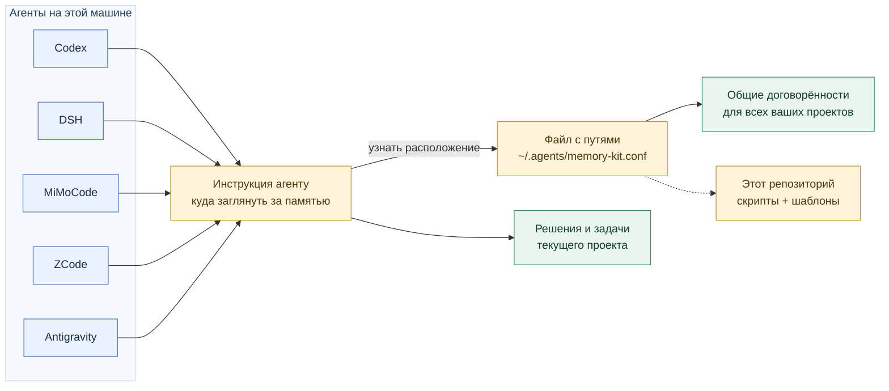

# Codex Memory Kit

**Помогает ИИ-помощнику продолжать работу в новом чате: прочитать ваши договорённости, решения по проекту и список следующих задач.** Всё это хранится в обычных текстовых файлах рядом с проектом и в отдельной папке для правил, действующих во всех ваших проектах.

Например, вы договорились с агентом сохранять пользовательские изменения, выбрали базу данных для приложения и остановились на настройке авторизации. Эти сведения можно записать в память. В следующей сессии агент получит инструкцию прочитать их, и вам будет проще продолжить работу без повторного пересказа.

Набор содержит готовые правила, шаблоны заметок и команды для их установки. Память пополняется записями агента по этим правилам или вашими правками. Полная история каждого чата автоматически сюда не копируется.

Поддерживаются **Codex, DSH, MiMoCode, ZCode и Antigravity**. Название репозитория сохранилось от первой версии; файлы памяти можно использовать с любым из этих агентов.

[Что здесь называется памятью](#что-здесь-называется-памятью) · [Быстрый старт](#быстрый-старт) · [Выбор агента](#выбор-агента) · [Что и куда сохранять](#что-и-куда-сохранять) · [Подробная настройка](docs/configuration.md)

## Что здесь называется памятью

| Название | Простое объяснение | Пример |
|---|---|---|
| **Общие правила** | Ваши договорённости с агентом, которые действуют во всех проектах | Как сохранять ваши изменения, проверять результат и фиксировать принятые решения. Хранятся в `global-collaboration-rules.md` |
| **Память проекта** | Файлы с решениями, пояснениями и задачами одного конкретного проекта | Почему выбрана эта база данных, что уже сделано и какой следующий шаг. Хранятся внутри папки проекта |
| **Адаптер** | Короткая инструкция в том файле, из которого конкретный агент читает указания для работы | Для DSH это обычно `~/.dsh/AGENTS.md`. Добавленный текст просит агента прочитать общие правила и файлы проекта |
| **Локатор** | Маленький служебный файл с путями: где на этом компьютере лежат общие правила и сам набор | `~/.agents/memory-kit.conf`. Установщик заполняет его сам; при обычной установке редактировать его не нужно |

Файлы с расширением `.md` — обычный текст в формате Markdown. Их можно открыть и изменить в любом текстовом редакторе. `~` в путях означает домашнюю папку вашего пользователя: например, `C:\Users\ВашеИмя` в Windows или `/home/ваше-имя` в Linux.

В общую папку также устанавливается `memory-architecture.md`: инструкция для агента, какие записи куда складывать и как пользоваться памятью. В репозитории можно заранее прочитать [готовые общие правила](templates/global/global-collaboration-rules.md) и [инструкцию ведения памяти](templates/global/memory-architecture.md), чтобы понять предлагаемые договорённости.

## Как устроена память



Общие договорённости хранятся в одном месте на компьютере. У каждого проекта свои решения и задачи. Несколько агентов могут читать одни и те же файлы; отдельную копию памяти для каждого создавать не нужно.

Связи на схеме означают, какие файлы агенту поручено прочитать. Сама Markdown-ссылка не загружает их содержимое: важно проверить чтение в новой сессии после установки.

## Выбор агента

Параметр `-Agent` в PowerShell или `--agent` в Bash указывает, для какой программы подготовить инструкцию чтения памяти.

| Ваш агент | Значение параметра | Куда по умолчанию добавляется инструкция |
|---|---|---|
| Codex | `codex` | `~/.codex/AGENTS.md` |
| DSH / DeepSeek Harness | `dsh` | `~/.dsh/AGENTS.md` |
| MiMoCode | `mimocode` | `~/.config/mimocode/AGENTS.md` |
| ZCode | `zcode` | `~/.zcode/AGENTS.md` |
| Antigravity | `antigravity` | `~/.gemini/GEMINI.md` |

Для Antigravity `init-project` также добавляет файл `.agents/rules/antigravity-memory-adapter.md` в проект. Его создаёт команда, вручную готовить его не нужно.

Если вы используете несколько агентов, `all` подготовит инструкции для всех пяти. Общие правила и записи проектов останутся едиными. Остальные параметры и нестандартные каталоги описаны в [подробной настройке](docs/configuration.md#каталоги-и-выбор-агента), а особенности загрузки каждого агента — в [совместимости](docs/harness-compatibility.md).

## Быстрый старт

Потребуются уже установленный агент из списка выше, Git для скачивания репозитория и одна из двух оболочек: **PowerShell** или **Bash**. Python нужен только разработчикам для запуска тестов.

Установка состоит из двух частей:

1. **Один раз на компьютере для выбранного агента:** подготовить общие правила и добавить инструкцию, где их читать.
2. **Для каждого нового проекта:** создать файлы его памяти в корне проекта — папке, где лежат его код и документы.

Сначала скачайте набор в удобное постоянное место и откройте его папку:

```bash
git clone https://github.com/phoenix0597/codex-memory-kit.git
cd codex-memory-kit
```

В этой папке находятся скрипты и шаблоны. Установленные общие правила и записи проекта будут храниться отдельно. Сохраните папку набора: из неё запускаются команды для следующих проектов.

Ниже показан пример для **DSH**. Если у вас другой агент, замените `dsh` во всех командах значением из [таблицы выбора агента](#выбор-агента). Выполните блоки только для своей оболочки.

### PowerShell

Подходят Windows PowerShell 5.1 и PowerShell 7+. **Первый блок выполняется из папки скачанного набора.**

```powershell
# Запомнить расположение набора для дальнейших команд.
$memoryKit = (Get-Location).Path

# Показать план установки, не изменяя файлы.
.\scripts\memory-kit.ps1 install -Agent dsh -DryRun

# Создать общие файлы и инструкцию подключения для DSH.
.\scripts\memory-kit.ps1 install -Agent dsh

# Проверить общие файлы и подключение DSH.
.\scripts\memory-kit.ps1 check -Agent dsh -Mode global -Strict
```

**Теперь в том же терминале перейдите в корень нового проекта.** Папка проекта уже должна существовать. Выполните:

```powershell
# Создать файлы памяти в текущем проекте.
& "$memoryKit\scripts\memory-kit.ps1" init-project -Agent dsh

# Проверить общую память и файлы этого проекта.
& "$memoryKit\scripts\memory-kit.ps1" check -Agent dsh -Strict
```

### Bash

Подходят Linux, macOS, WSL и Git Bash; используются стандартные утилиты `sed`, `awk`, `grep`, `find` и `cp`. **Первый блок выполняется из папки скачанного набора.**

```bash
# Запомнить расположение набора для дальнейших команд.
memory_kit=$(pwd -P)

# Показать план установки, не изменяя файлы.
./scripts/install.sh --agent dsh --dry-run

# Создать общие файлы и инструкцию подключения для DSH.
./scripts/install.sh --agent dsh

# Проверить общие файлы и подключение DSH.
./scripts/check.sh --agent dsh --mode global --strict
```

**Теперь в том же терминале перейдите в корень нового проекта.** Папка проекта уже должна существовать. Выполните:

```bash
# Создать файлы памяти в текущем проекте.
"$memory_kit/scripts/init-project.sh" --agent dsh

# Проверить общую память и файлы этого проекта.
"$memory_kit/scripts/check.sh" --agent dsh --strict
```

### Что должно получиться

После `install` в новой установке общие файлы находятся в `~/.agents/memories`, файл с путями — в `~/.agents/memory-kit.conf`, а инструкция для DSH — в `~/.dsh/AGENTS.md`. У других агентов своё место для этой инструкции, указанное в [таблице выбора агента](#выбор-агента). Если память на компьютере уже настроена, используется её сохранённое расположение.

После `init-project` в текущем проекте появятся `AGENTS.md`, `START-HERE.md`, `assistant-memory.md` и папка `memory/` с очередью задач, первой дневной заметкой и шаблонами для следующих записей. Их назначение объясняется в разделе [«Что и куда сохранять»](#что-и-куда-сохранять).

`check` завершает проверку без изменения файлов. Строки `CHECK OK` показывают найденные файлы; дождитесь завершения и убедитесь, что нет `CHECK FAIL` или сообщения об ошибке. Параметр `Strict` / `--strict` включает дополнительные проверки ссылок и содержимого. `Mode global` / `--mode global` проверяет только общую часть; без него проверяется и текущий проект.

При повторном запуске установщик сохраняет существующие файлы памяти. `SKIP` в выводе означает, что файл оставлен без изменений. Если ранее добавленная инструкция подключения отличается от шаблона, команда сообщит об этом; порядок её обновления описан [отдельно](docs/configuration.md#существующие-установки-и-обновления).

Команды `init-project` и `check` без `Repo` / `--repo` используют текущую папку. Скрипты остаются в папке набора; копировать их в проект не нужно. Переменная `$memoryKit` или `$memory_kit` сохраняется в том же терминале. Если вы открыли новый терминал, расположение набора можно посмотреть в поле `KIT_ROOT` файла `~/.agents/memory-kit.conf` и снова записать в переменную. Пути с пробелами заключайте в кавычки.

### Первая сессия с памятью

Начните **новую сессию агента из корня проекта**. Например, попросите:

> Прочитай AGENTS.md и START-HERE.md этого проекта и общие правила, на которые они указывают. Назови прочитанные файлы и кратко опиши, что уже известно о проекте и какой следующий шаг записан в очереди.

Сверьте названные пути и сведения с созданными файлами. Где приложение показывает загруженные инструкции или обращения к файлам, проверьте и их. `check` подтверждает устройство файлов, а фактическое чтение агентом проверяется в сессии. Подробный порядок и особенности программ приведены в [совместимости агентов](docs/harness-compatibility.md#проверка-в-реальной-сессии).

## Что и куда сохранять

Общие договорённости относятся ко всем проектам. В новой установке они находятся в `~/.agents/memories`:

| Файл | Для чего он нужен |
|---|---|
| `global-collaboration-rules.md` | Ваши общие требования к работе агента: как согласовывать действия, проверять результаты и сохранять решения |
| `memory-architecture.md` | Порядок чтения и ведения памяти, назначение файлов и особенности разных агентов |

Файлы отдельного проекта лежат в его корне и папке `memory/`:

| Файл | Для чего он нужен |
|---|---|
| `AGENTS.md` | Первая инструкция агенту: какие правила и записи прочитать перед работой |
| `START-HERE.md` | Короткий путеводитель по проекту и его файлам памяти |
| `assistant-memory.md` | Принятые решения и устойчивые договорённости по этому проекту |
| `memory/current-work-queue.md` | Что делаем сейчас и какие шаги следующие |
| `memory/YYYY-MM-DD.md` | Короткие итоги работы за день |
| `memory/topic-<slug>.md` | Подробные пояснения по отдельной теме; вместо `<slug>` — короткое название |
| `memory/_templates/` | Образцы для новых дневных и тематических заметок |

Например, «проверять изменения перед коммитом» относится к общим правилам, «для этого приложения выбрали PostgreSQL» — к `assistant-memory.md`, а «следующим шагом добавить вход по почте» — к очереди задач. Дневная заметка хранит краткий результат, который пригодится для продолжения работы.

Вы можете править эти файлы сами или поручать агенту сохранять принятые решения. После установки личные общие правила меняются в **установленной папке памяти**; её точное расположение записано в `memory-kit.conf`. Файлы внутри `templates/` этого репозитория служат исходными образцами. Изменение образца не переписывает уже установленную память.

## Существующие установки и обновления

Для новых проектов используйте обычные команды из быстрого старта. Обновление репозитория само по себе не меняет память ранее созданных проектов или ваши установленные общие правила.

Если нужно обновить добавленную инструкцию подключения, есть `UpdateAdapters` / `--update-adapters`. Он сохраняет существующие содержательные файлы памяти и меняет управляемый текст подключения. Порядок, предварительный просмотр и отличие от более широкого `Force` / `--force` описаны в [инструкции по обновлению](docs/configuration.md#существующие-установки-и-обновления).

Домашний `~/AGENTS.md` как отдельный индекс набор не создаёт и не обслуживает. Существующий пользовательский файл автоматически не удаляется и не изменяется.

## Экспорт и импорт

Чтобы продолжить работу на другом компьютере, можно собрать общие правила и выбранную память проекта в папку экспорта, затем импортировать её на новом месте. При импорте пути подключения настраиваются для новой машины, а текст ваших записей сохраняется.

Команды, выбор проекта и ограничения старых архивов приведены в [инструкции переноса](docs/configuration.md#экспорт-и-импорт).

## Разработка и подробности

Интеграционные тесты выполняют установку и перенос во временных папках:

```bash
python -m unittest discover -s tests -v
```

Для тестов нужен Python. Используются доступные Bash, Windows PowerShell и PowerShell 7. Переменная `MEMORY_KIT_TEST_BACKENDS=bash,powershell,pwsh` выбирает оболочки и требует их наличия. Проверку совместимости оболочек включает `MEMORY_KIT_TEST_INTEROP=1`. Реальные модельные сессии тесты не запускают.

[GitHub Actions](.github/workflows/test.yml) проверяет Bash и PowerShell 7 на Linux, macOS и Windows, а Windows PowerShell 5.1 — на Windows. [Результаты запусков CI](https://github.com/phoenix0597/codex-memory-kit/actions).

- [Подробная настройка путей, обновления, проверки и перенос](docs/configuration.md).
- [Совместимость агентов, версии и первичные источники](docs/harness-compatibility.md).
- [Общие правила](templates/global/global-collaboration-rules.md) и [инструкция ведения памяти](templates/global/memory-architecture.md).
- [Проектные шаблоны](templates/project/) и [инструкции подключения](templates/agent/).
- [Примеры переменных](examples/project-vars.env.example) — справка для настройки, а не исполняемый файл.
